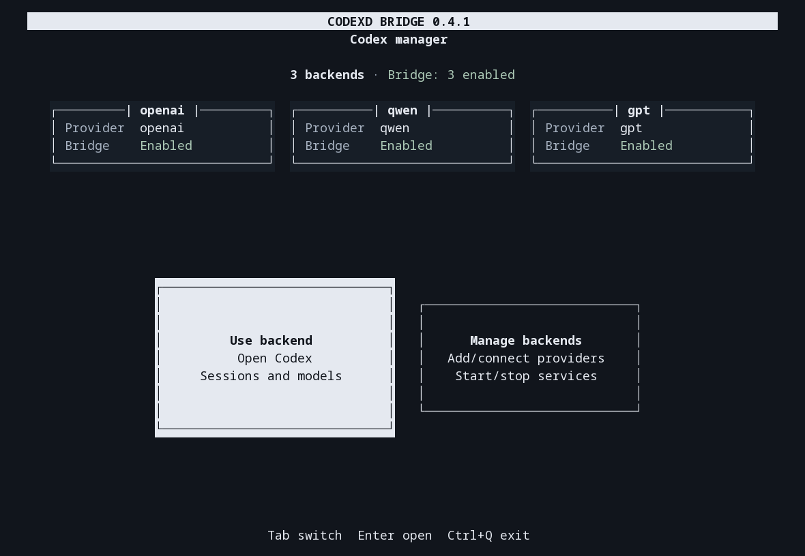
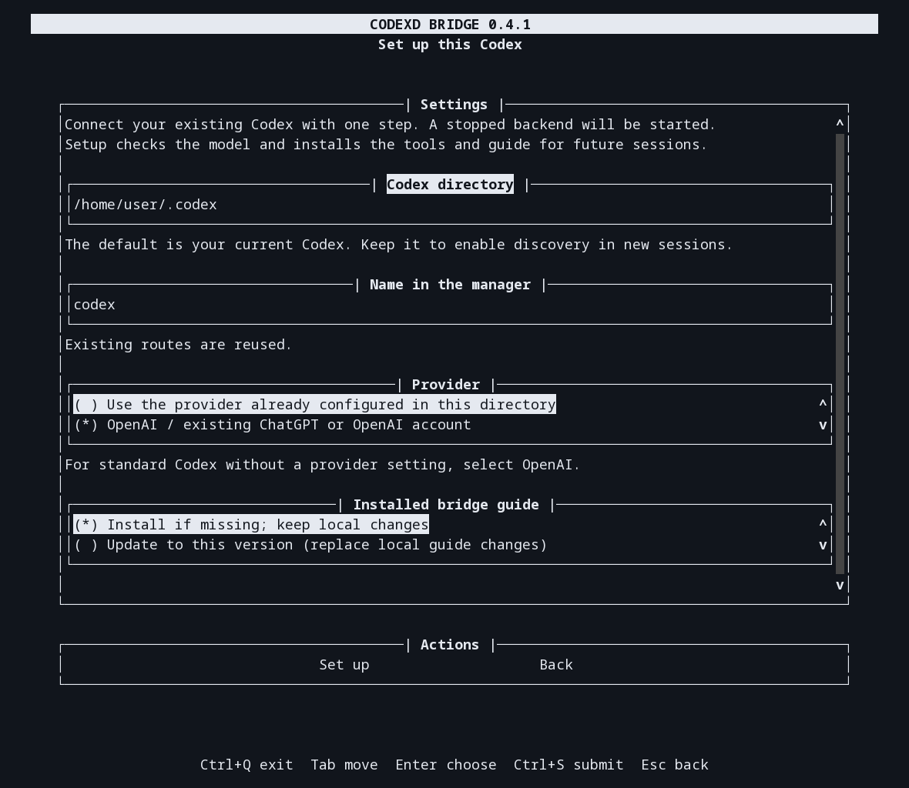
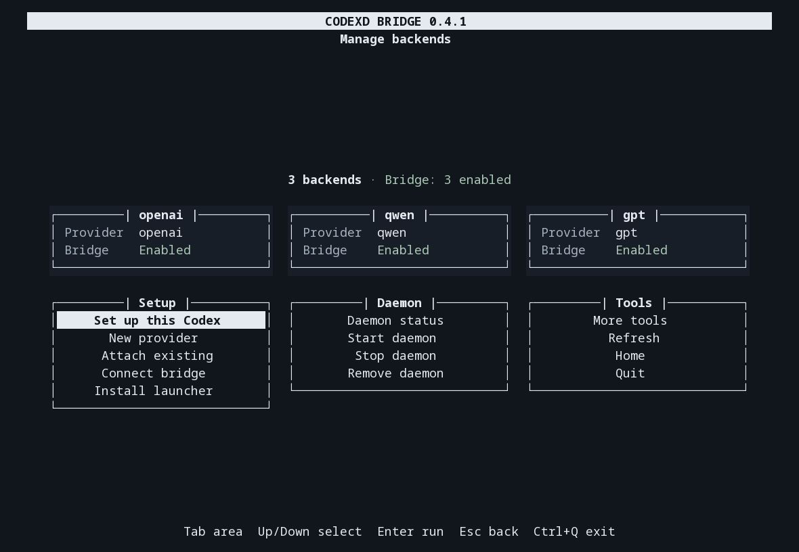

# Codex Daemon Bridge

[](README.md) [](README.zh-CN.md)

Manage independent Codex daemons, discover provider models, and delegate tasks across providers through MCP.
A keyboard TUI guides setup and everyday operations.



*Running home screen: centered character cards expand slightly and invert their colors when focused.*

## Prerequisites

- Linux (including WSL), Python 3.11+ with `venv`, and the `codex` CLI.
- An existing configured Codex home, or provider access through an API key environment variable.

## Install

1. Download `codexd_bridge-VERSION.tar.gz` from [GitHub Releases](https://github.com/Aegyce/codexd-bridge/releases).
2. Extract it and run `./install.sh` from the extracted directory.
3. Follow the TUI opened by the installer. Later, run `codexd-bridge` from any directory.

The installer creates an independent Python environment and configures the command path for Bash, Zsh or Fish.
If the command is unavailable in your current terminal, open a new one. Installation needs no `sudo` or
virtual-environment activation; the downloaded directory can be deleted afterwards.

<details>
<summary>Install from a Git checkout</summary>

```bash
git clone https://github.com/Aegyce/codexd-bridge.git
cd codexd-bridge
./install.sh
```

For automated installation, use `./install.sh --no-launch`.

</details>

## Connect your existing Codex

```bash
codexd-bridge
```

1. Choose **Manage backends → Set up this Codex**.
2. Keep the suggested Codex directory and name, or select the existing home you want to connect.
3. Use its configured provider. For standard Codex without an explicit provider setting, choose **OpenAI**.
4. Choose **Set up**. The manager starts the backend if needed, verifies model access, installs the guide and registers MCP tools.

New Codex sessions using that home discover the bridge automatically. Existing sessions may need to reconnect.
Failed setup keeps your input and offers a retry action.



*Setup form captured from the running TUI with a demonstration directory.*

## Add another provider

Export the provider's API key environment variable before opening the manager, then choose **Manage backends → New provider**.
The service must support the Responses API.

| Form field | What to enter |
| --- | --- |
| Provider name | A short name such as `demo`; its launcher will be `codex-demo` |
| API endpoint | The provider's Responses API base URL |
| API key environment variable | The variable **name**, such as `DEMO_API_KEY`; the bridge does not save its value |
| Model ID | The exact model identifier supplied by the provider |
| Context limit | The model's documented token limit |
| Reasoning effort | Optional; leave blank to use the provider default |

Choose **Create provider** once to create the configuration, verify a real response, enable the route and
install its launcher. If setup is incomplete, choose **Retry connection**.

## Everyday operations

The home screen has two cards:

- **Use backend:** open Codex, browse models and manage sessions.
- **Manage backends:** add configurations, connect the bridge, manage services and uninstall.

The read-only overview groups each backend's name, provider and bridge status in one block, with totals above.
Short terminals show the totals; additional backends are counted below when space is limited. When an operation needs a target,
one configured environment is used directly; with several, choose one and press `Enter`.
**Daemon status** checks whether its Codex service is running. Closing the manager leaves running services active.



| Goal | TUI entry | Result |
| --- | --- | --- |
| Reuse a Codex home | **Manage backends → Attach existing** | Adds an existing home to the manager |
| Connect or refresh bridge tools | **Manage backends → Connect bridge** | Verifies model access and installs the guide and MCP integration |
| Browse or verify models | **Use backend → Models** / **All models** | Shows one backend or all configured backends |
| Manage tasks | **Use backend → Sessions** | Create, continue, fork or steer a task |
| Check, start or stop a daemon | **Manage backends → Daemon status** / **Start daemon** / **Stop daemon** | Acts on the selected backend |
| Install `codex-NAME` | **Manage backends → Install launcher** | Installs the command without starting a daemon or requesting a model response |
| Open native Codex | **Use backend → Open Codex** | Opens the selected provider; returns to the manager when it closes |
| Find additional operations | **Manage backends → More tools** | Daemon configuration, registry selection, custom model checks, native arguments, diagnostics, MCP details and uninstall |

**Keyboard:** `Tab` / `Shift+Tab` switch cards or function areas; `↑` / `↓` select within an area.
In forms, `Tab` moves between fields. `Enter` selects · `Ctrl+S` submits · `Esc` returns · `Ctrl+Q` exits.
The minimum terminal size is 60 columns by 18 rows. Stopping a daemon requires confirmation;
unattended delegation is enabled only when explicitly selected under **Connect bridge**.

## Upgrade

- Run `./install.sh` from the newer download. It refreshes owned, enabled MCP registrations and unchanged bundled guides without restarting daemons. A failed build keeps the working version.
- If a guide has local edits or refresh is incomplete, review the changes, then use **Manage backends → Set up this Codex → Update to this version**.
- For other package-manager installations, update the package and use **Connect bridge → Update the installed bridge skill** on each backend.
- Recorded task ancestry survives state migration. Older bridge versions cannot read the upgraded state; old tasks without recorded ancestry need fresh sessions.

## Delegate tasks

- Every created or forked task gets a fresh assignment: ID, session type, parent and history source, root ancestry, depth, task requirements and acceptance criteria.
- Set `session_type` (such as `worker` or `reviewer`), `prompt` and `acceptance_criteria`. Omitted criteria are marked as unspecified. Assignments appear in the first message and in session reads.
- Children can fork again, recording their immediate parent. Delegation defaults to eight levels; dispatch back to the caller or its recorded ancestors is rejected. Steer an active task using its current turn ID.

## Remove a daemon or uninstall the project

| Action | Command | Effect |
| --- | --- | --- |
| Remove one daemon | `codexd-bridge daemon remove NAME` | Stops it and removes its registration, bridge integration and unchanged launcher; retains configuration, credentials and sessions |
| Remove one daemon and its data | `codexd-bridge daemon remove NAME --purge` | Also deletes that daemon's data |
| Uninstall the bridge | `codexd-bridge uninstall` | Removes the bridge program and owned integrations; retains independent daemons and their data |

- **TUI:** enter **Manage backends**, then choose **Remove daemon** or **More tools → Uninstall bridge**. Destructive actions ask for confirmation; data deletion also requires the backend name.
- Stopping or removing a daemon interrupts its active tasks. Retained data can be reconnected through **Attach existing**; a failed removal leaves a disabled registration for retry.
- Data deletion refuses protected or shared homes and directories containing the bridge, its registry or another backend.
- `./uninstall.sh` is an alternative for project removal. Uninstall preserves locally edited guides and unrelated commands.

## Command-line reference

| Task | Command |
| --- | --- |
| Diagnose installation and provider configuration | `codexd-bridge doctor` |
| Show the installed version | `codexd-bridge --version` |
| List automation commands | `codexd-bridge --help` |
| Open another registry | `codexd-bridge --config /absolute/bridge.toml ui` |
| Start the MCP stdio entry point | `codexd-bridge serve` |

Diagnostics make no model requests, print JSON and exit with status 1 on errors.
They are also available under **Manage backends → More tools → Diagnostics**.

See the [release guide](docs/releasing.md) for validation results and unverified platforms/models,
the [architecture](docs/architecture.md) for session and failure behavior, and the [changelog](CHANGELOG.md) for improvements.

## License

Original content: [CC BY-NC 4.0](LICENSE); commercial use requires [separate written permission](COMMERCIAL-LICENSE.md).
Third-party dependencies keep their licenses.
