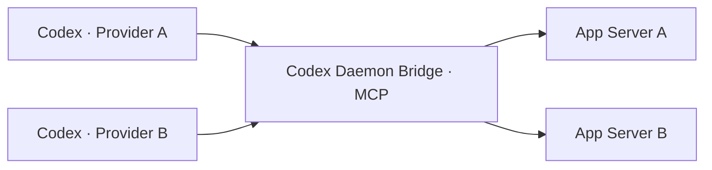

# Codex Daemon Bridge

通过 MCP 协调不同 provider 的 Codex 会话。每个后台保留自己的 daemon、模型配置和会话数据；接入桥接的 Codex 会话可向其他已启用后台派发任务、读取结果并继续沟通。<br><sub>Coordinate Codex sessions across providers through MCP. Each backend retains its own daemon, model configuration, and session data. A Codex session connected to the bridge can delegate tasks to other enabled backends, read results, and continue the conversation.</sub>

桥接层复用原生 App Server 会话接口，通过本地 Unix socket 路由请求。模型调用由目标后台执行；桥接层不保存模型密钥，也不为每项任务启动 CLI 进程。<br><sub>The bridge routes native App Server operations over local Unix sockets. The target backend executes model requests; the bridge stores no model credentials and starts no per-task CLI process.</sub>



## 安装<br><sub>Installation</sub>

需要 Python 3.11+、POSIX 文件锁与 Unix socket；当前验证环境为 Linux x86_64、Python 3.11 和 3.12；生命周期命令依赖已安装的 `codex` CLI。协议适配以 Codex 0.167.2 为基准。<br><sub>Requires Python 3.11+, POSIX file locking, and Unix sockets; validated on Linux x86_64 with Python 3.11 and 3.12; lifecycle commands use the installed `codex` CLI. The protocol integration targets Codex 0.167.2.</sub>

```bash
python3 -m venv .venv
.venv/bin/pip install --require-hashes -r requirements.lock
.venv/bin/pip install --no-deps .
source .venv/bin/activate
mkdir -p ~/.config/codexd-bridge
```

可执行文件安装为 `.venv/bin/codexd-bridge`；发现技能随包分发，由 `connect` 装入各后台 home。<br><sub>The executable installs as `.venv/bin/codexd-bridge`; the discovery skill ships with the package and is installed into each backend home by `connect`.</sub>

## 命令行<br><sub>Command line</sub>

全局 `--config` 必须位于子命令之前；配置优先级为 `--config`、`CODEXD_BRIDGE_CONFIG`、`~/.config/codexd-bridge/config.toml`。命令输出 JSON，失败以退出码 2 结束。注册表文件及其父目录可由 `daemon create` 自动创建。<br><sub>The global `--config` must precede the subcommand. Precedence is `--config`, `CODEXD_BRIDGE_CONFIG`, then `~/.config/codexd-bridge/config.toml`. Commands print JSON and exit with code 2 on failure. `daemon create` can create the registry file and its parent directories.</sub>

### 后台生命周期<br><sub>Daemon lifecycle</sub>

`daemon create` 生成全新隔离 home（仅配置，目录 0700、config.toml 0600），并将路由注册为 `enabled = false`；不启动 daemon、不做推理。`--home` 必须尚不存在（含悬空符号链接），其父目录必须已存在。非内置 provider 必须提供 `--template-home`：仅复制白名单内的非秘密连接字段（如 base_url、wire_api、env_key 变量名引用），auth.json 与环境变量值从不读取，原生凭据由用户自行提供给目标 daemon；`model_catalog_json` 仅复制路径引用，不读取文件内容。<br><sub>`daemon create` generates a fresh isolated home (configuration only, 0700 directory, 0600 config.toml) and registers the route with `enabled = false`; it never starts a daemon or runs inference. `--home` must not exist in any form (including dangling symlinks) and its parent must already exist. Non-built-in providers require `--template-home`: only allow-listed non-secret connection fields are copied (e.g. base_url, wire_api, env_key variable-name references). auth.json and environment variable values are never read; native credentials are supplied by the user to the target daemon. `model_catalog_json` is copied as a path reference only, never read.</sub>

`daemon start|status|stop` 以仅覆盖 `CODEX_HOME` 的环境执行原生 `codex app-server daemon start|version|stop`。start 前校验 home 配置的 provider 绑定；status/stop 跳过该校验。无 restart、无自动重试；start/stop 的返回只反映 CLI 退出状态，就绪以 status 为准；超时后先查 status 再决定重试。失败输出写入 home/daemon-logs 私有日志。<br><sub>`daemon start|status|stop` runs the native `codex app-server daemon start|version|stop` with only `CODEX_HOME` overridden. start verifies the home's provider binding first; status/stop skip that check. There is no restart and no automatic retry. start/stop results reflect the CLI exit status only; confirm readiness with status, and query status before retrying after a timeout. Failure output is written to private logs under home/daemon-logs.</sub>

```bash
codexd-bridge daemon create demo \
  --home /absolute/path/homes/demo \
  --provider my-provider --model my-model \
  --template-home /absolute/path/template-home
codexd-bridge daemon start demo
codexd-bridge daemon status demo
codexd-bridge daemon list
```

`--effort` 可选；`daemon list` 只列出路由。完成工作后可用 `daemon stop demo` 停止该后台。<br><sub>`--effort` is optional; `daemon list` only lists routes. Use `daemon stop demo` to stop that backend after use.</sub>

### 接入<br><sub>Connect</sub>

`connect` 面向已运行的 daemon，按序执行：真实推理验证 → 安装发现技能 → 注册 MCP 服务 → 启用路由；验证失败则不安装、不注册、不启用。技能装入 `<home>/skills/codexd-bridge`，让该后台未来的 Codex 会话识别桥接工具与路由规则；内容一致时不重复写入。升级后若内容不同，默认保留已安装文件；核对本地修改后，可用 `connect demo --update-skill` 显式替换，替换失败会恢复旧版本。注册通过原生批量配置接口，仅更新桥接层管理的字段，保留其他服务、环境变量与审批设置；刷新后确认当前版本的 MCP 工具可用，才执行启用步骤。被上层策略覆盖时报告 `effective=false` 且不执行启用步骤，原有启用状态保持不变。<br><sub>`connect` targets a running daemon and proceeds in order: real-inference verification, discovery-skill installation, MCP registration, then route enabling; a failed verification installs, registers, and enables nothing. The skill is installed at `<home>/skills/codexd-bridge` so future Codex sessions on that backend recognize the bridge tools and routing rules; identical content is left unchanged. After an upgrade, differing installed files are preserved by default; review local edits and use `connect demo --update-skill` to replace them explicitly. A failed replacement restores the previous version. Registration uses the native batch configuration API to update only bridge-managed fields, preserving other services, environment variables, and approval settings. After reload, it confirms that the current bridge version exposes tools before enabling the route. A policy override reports `effective=false` and skips enabling, preserving its previous enabled state.</sub>

`--allow-session-writes` 是用户显式选项：仅当传入时，才将 create_session、send_message、fork_session、steer_session 四项工具的 approval_mode 设为 approve，其余工具与默认策略不变。返回的 `session_write_approval_requested` 表示本次是否请求授权，不表示已保存的审批状态。默认保留现有审批策略；未获授权时调用方可能遇到审批提示，应走正常审批流程。`--executable` 缺省取当前 Python 旁或 PATH 中的已安装可执行文件。<br><sub>`--allow-session-writes` is an explicit user opt-in: only when passed does it set approval_mode=approve for the four tools create_session, send_message, fork_session, and steer_session, leaving all other tools and default policies unchanged. `session_write_approval_requested` records the current request, not the saved approval state. Existing policies are preserved by default; without authorization, callers may hit approval prompts and should use the normal approval flow. `--executable` defaults to the installed executable next to the running Python or on PATH.</sub>

```bash
codexd-bridge connect demo
codexd-bridge connect demo --allow-session-writes
```

### 模型发现与验证<br><sub>Model discovery and verification</sub>

`models list` 动态查询各后台的 `model/list` 并聚合，逐后台标注 reachable/error；不维护静态模型清单。daemon 可能使用自身缓存或配置，模型出现在列表中不等于实际可用。分页须用 `--backend` 加 `--cursor`。`models check` 在目标后台发起一次真实短推理，要求精确标记回复，随后删除该临时 thread（先中断自身未完成的 turn）；清理失败会报告 thread ID，创建结果不明时须先查目标后台；可在启用前运行，不启用路由、不改注册表、不自动重试，返回不含密钥的证据。<br><sub>`models list` dynamically queries each backend's `model/list` and aggregates the results with per-backend reachable/error flags; no static model list is maintained. A daemon may use its own cache or configuration; catalog presence does not prove actual availability. Pagination requires `--backend` with `--cursor`. `models check` runs one short real inference on the target backend, requires the exact marker reply, and deletes the temporary thread afterwards (interrupting its own unfinished turn first). Cleanup failures report the thread ID; an uncertain creation outcome requires inspecting the target backend. It can run before enabling, never enables the route or edits the registry, never retries automatically, and returns secret-free evidence.</sub>

```bash
codexd-bridge models list
codexd-bridge models list --backend demo --cursor 'NEXT_CURSOR'
codexd-bridge models check demo --model my-model --effort high
```

## 注册表<br><sub>Registry</sub>

路由字段为 home、model_provider、default_model、default_effort、enabled。手写条目省略 enabled 时按 true 解析；`daemon create` 注册为 false。会话写工具（create/send/fork/steer）要求路由已启用；读取与发现不受此限。后台目录失效按该后台不可用处理，不阻断其他路由。注册表更新在锁内原子替换，其他路由的字段值保持不变。<br><sub>Route fields are home, model_provider, default_model, default_effort, and enabled. Hand-written entries omitting enabled parse as true; `daemon create` registers false. Session mutation tools (create/send/fork/steer) require an enabled route; reads and discovery do not. An unavailable home affects only that backend and does not block other routes. Registry updates are atomic under a lock and preserve the field values of every other route.</sub>

```toml
[backends.demo]
home = "/absolute/path/homes/demo"
model_provider = "my-provider"
default_model = "my-model"
enabled = false
```

## 会话操作（MCP）<br><sub>Session operations (MCP)</sub>

先用 `list_backends` 查看后台，再用 `list_provider_models` 汇总候选模型，或用 `list_models` 分页查询某个后台的模型与推理强度。`create_session.backend` 选择接收任务的后台，与调用方自身 provider 无关；供应商不静默回退。<br><sub>Inspect backends with `list_backends`, aggregate candidate models with `list_provider_models`, or page through one backend’s models and reasoning efforts with `list_models`. `create_session.backend` selects the destination independently of the caller's provider; providers never fall back silently.</sub>

| 工具 / Tool | 用途 / Purpose |
| --- | --- |
| `list_backends`, `list_provider_models`, `list_models` | 发现后台与模型能力<br><sub>Discover routes and model capabilities</sub> |
| `list_sessions`, `read_session`, `read_messages` | 查阅状态与分页消息<br><sub>Read status and paginated messages</sub> |
| `create_session` | 向目标后台派发独立任务<br><sub>Delegate a new task to the destination</sub> |
| `send_message` | 继续空闲会话<br><sub>Continue an idle session</sub> |
| `steer_session` | 向指定活动 turn 补充要求<br><sub>Add instructions to a specific active turn</sub> |
| `fork_session` | 在原供应商下派生会话<br><sub>Fork a session within its existing provider</sub> |

新建、继续、派生支持 model/effort：继续与派生省略时继承原会话设置，后台默认值仅用于新建；显式模型须在目标目录中登记，选择与实际不一致时不启动推理。`cwd` 必须是目标机器上的现有绝对目录。旧会话缺少模型或强度元数据时，继续或派生须显式补齐缺失项。<br><sub>Creation, continuation, and forking accept model/effort. Continuation and forking inherit the original session settings when omitted; backend defaults apply only to new sessions. Explicit models must appear in the target catalog, and selection mismatches prevent inference. `cwd` must be an existing absolute directory on the target machine. If an older session lacks model or reasoning metadata, provide the missing selection explicitly.</sub>

## 运行边界<br><sub>Operational boundaries</sub>

- 凭据由各 daemon 保管；桥接不复制 auth.json 或凭据文件；模板只复制非秘密连接字段，启动 daemon 时继承调用环境。<br><sub>Credentials stay with each daemon; the bridge copies neither auth.json nor credential files. Templates supply non-secret connection fields, and daemon startup inherits the caller’s environment.</sub>
- MCP 工具不启动、不重启 daemon；启停仅通过显式 CLI 生命周期命令。连接失败返回错误，不切换供应商。<br><sub>MCP tools never start or restart daemons; lifecycle changes happen only through explicit CLI commands. Connection failures return errors without switching providers.</sub>
- 发送成功表示已受理，需 `read_session` 确认结果；消息分页不含工具输出与内部推理。超时或断线后先查会话再决定是否重试。<br><sub>A successful send means acceptance; confirm results with `read_session`. Message pagination omits tool output and internal reasoning. Inspect session state after timeouts or disconnects before retrying.</sub>
- 活动 turn 使用带 `expected_turn_id` 的 `steer_session`。`send_message` 的空闲检查非原子：其他客户端在最后一刻启动 turn 时，输入可能按原生语义加入该 turn。<br><sub>Active turns require `steer_session` with `expected_turn_id`. The `send_message` idleness check is not atomic: if another client starts a turn at the final instant, input may join that turn under native semantics.</sub>
- 新会话使用 read-only/workspace-write 沙箱与 never 审批策略；继续、派生保留原会话权限。网络与执行能力仍受目标沙箱约束。<br><sub>New sessions use a read-only/workspace-write sandbox with the never approval policy; continuation and forking preserve existing permissions. Network and execution access remain subject to the target sandbox.</sub>
- 跨 provider 协作通过目标后台的新会话与后续消息实现；thread ID 属于原后台，派生不迁移供应商、不自动复制历史，必要上下文写入派发提示。<br><sub>Cross-provider collaboration uses destination sessions and follow-up messages. A thread ID stays with its original backend; forking neither migrates providers nor copies history automatically. Include the necessary context in the delegated prompt.</sub>

## 验证与维护<br><sub>Validation and maintenance</sub>

`requirements.lock` 锁定运行依赖版本及发行文件的 SHA-256，构建工具版本由 `pyproject.toml` 锁定。在源码目录使用已安装的环境运行以下检查；回归测试使用临时目录和模拟后台，不需要真实模型凭据。<br><sub>`requirements.lock` pins runtime dependency versions and distribution SHA-256 hashes; `pyproject.toml` pins the build backend. Run these checks from the checkout using the installed environment; regression tests use temporary directories and mock backends without real model credentials.</sub>

```bash
python -m pip check
python -m unittest discover -s tests -q
```

## 许可<br><sub>Licensing</sub>

原创内容采用 [CC BY-NC 4.0](LICENSE)，商业用途须取得[单独书面授权](COMMERCIAL-LICENSE.md)。第三方依赖保留其各自许可。<br><sub>Original content is licensed under [CC BY-NC 4.0](LICENSE); commercial use requires [separate written permission](COMMERCIAL-LICENSE.md). Third-party dependencies retain their respective licenses.</sub>
