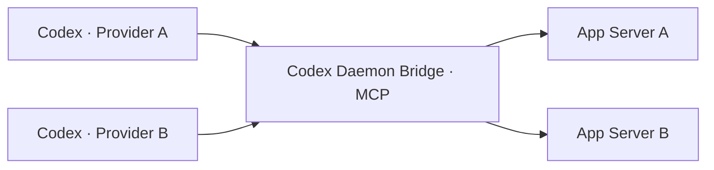

# Codex Daemon Bridge

通过 MCP 协调不同 provider 的 Codex 会话。每个后台保留自己的 daemon、模型配置和会话数据；任一接入桥接工具的 Codex 会话都能向其他后台派发任务、读取结果并继续沟通。<br><sub>Coordinate Codex sessions across providers through MCP. Each backend retains its own daemon, model configuration, and session data. Any Codex session connected to the bridge can delegate tasks to another backend, read results, and continue the conversation.</sub>

桥接层复用原生 App Server 会话接口，通过本地 Unix socket 路由请求。模型调用仍由目标后台执行，桥接层不保存模型密钥，也不为每项任务启动 CLI 进程。<br><sub>The bridge routes native App Server operations over local Unix sockets. The target backend executes model requests; the bridge stores no model credentials and starts no per-task CLI process.</sub>



## 安装与接入<br><sub>Installation and setup</sub>

需要 Python 3.11+、支持 Unix socket 的系统及已启动的 Codex App Server。当前协议适配以 Codex 0.167.2 为基准。<br><sub>Requires Python 3.11+, a system with Unix sockets, and running Codex App Servers. The protocol integration targets Codex 0.167.2.</sub>

```bash
python3 -m venv .venv
.venv/bin/pip install -r requirements.lock
.venv/bin/pip install --no-deps .
mkdir -p ~/.config/codexd-bridge
cp examples/bridge.toml ~/.config/codexd-bridge/config.toml
```

编辑配置，只登记需要接入的后台。`home` 是目标 daemon 的 `CODEX_HOME`；`model_provider` 必须与其供应商标识一致。别名可以自由命名，项目不限定 Qwen、OpenAI 或其他供应商。模型、推理强度的默认值可省略，由目标后台决定。<br><sub>Edit the configuration to register the intended backends. `home` is the target daemon's `CODEX_HOME`; `model_provider` must match its provider ID. Route aliases are configurable, with no fixed provider list. Model and reasoning defaults are optional and otherwise come from the target daemon.</sub>

在需要参与跨 provider 协作的每个 Codex 后台中注册同一 MCP 服务。将下面的绝对路径替换为实际安装位置，随后重新加载该后台的 MCP 配置。<br><sub>Register the same MCP service in every Codex backend participating in cross-provider collaboration. Replace the absolute paths below with the installation paths, then reload that backend's MCP configuration.</sub>

```toml
[mcp_servers.codexd-bridge]
command = "/absolute/path/codexd-bridge/.venv/bin/codexd-bridge"
args = ["--config", "/absolute/path/bridge.toml"]
enabled = true
startup_timeout_sec = 20
tool_timeout_sec = 60
```

配置路径的优先级为 `--config`、`CODEXD_BRIDGE_CONFIG`、`~/.config/codexd-bridge/config.toml`。连接失败会返回错误，不会切换供应商或自动启动、重启后台。<br><sub>Configuration precedence is `--config`, `CODEXD_BRIDGE_CONFIG`, then `~/.config/codexd-bridge/config.toml`. Connection failures return errors without switching providers or starting or restarting daemons.</sub>

后台自动协作还需要调用方允许会话写操作。如果 Codex 返回 `MCP tool call requires approval, but approval policy is never`，需通过正常审批流程授权，或在明确授权自动委派后合并[四项工具的配置示例](examples/mcp-unattended.toml)。桥接服务不会自行修改审批策略，读写属性按实际操作标注。配置依据见 [Codex MCP 文档](https://learn.chatgpt.com/docs/extend/mcp)。<br><sub>Unattended collaboration also requires the caller to authorize session mutations. If Codex returns `MCP tool call requires approval, but approval policy is never`, use the normal approval flow or, after explicitly authorizing unattended delegation, merge the [four-tool configuration example](examples/mcp-unattended.toml). The bridge does not change approval policy and reports truthful read/write annotations. See the [Codex MCP documentation](https://learn.chatgpt.com/docs/extend/mcp).</sub>

## 会话操作<br><sub>Session operations</sub>

先用 `list_backends` 选择目标后台，再用 `list_models` 查询其模型和推理强度。跨 provider 派发时，`create_session` 的 `backend` 选择接收任务的后台，与调用方自身的 provider 无关。<br><sub>Select a destination with `list_backends`, then inspect its models and reasoning efforts with `list_models`. For cross-provider delegation, `create_session.backend` selects the destination independently of the caller's provider.</sub>

| 工具 / Tool | 用途 / Purpose |
| --- | --- |
| `list_backends`, `list_models` | 发现后台与模型能力<br><sub>Discover routes and model capabilities</sub> |
| `list_sessions`, `read_session`, `read_messages` | 查阅状态与分页消息<br><sub>Read status and paginated messages</sub> |
| `create_session` | 向目标后台派发独立任务<br><sub>Delegate a new task to the destination</sub> |
| `send_message` | 继续空闲会话<br><sub>Continue an idle session</sub> |
| `steer_session` | 向指定活动 turn 补充要求<br><sub>Add instructions to a specific active turn</sub> |
| `fork_session` | 在原供应商下派生会话<br><sub>Fork a session within its existing provider</sub> |

例如，OpenAI 会话可向 Qwen 派发任务；Qwen 会话也可使用同一接口将 `backend` 指向 OpenAI。`cwd` 必须是目标机器上的现有绝对目录。<br><sub>For example, an OpenAI session can delegate to Qwen; a Qwen session can use the same interface with an OpenAI destination. `cwd` must be an existing absolute directory on the target machine.</sub>

```json
{
  "backend": "qwen",
  "title": "Review configuration loading",
  "prompt": "Review config.py without changing files. Report concrete defects and evidence.",
  "cwd": "/absolute/path/project",
  "model": "qwen4-max-preview",
  "effort": "high",
  "sandbox": "read-only"
}
```

新建、继续和派生均支持 `model`、`effort`。继续和派生时省略参数会继承原会话设置；后台默认值只用于新建。供应商、模型或强度与请求不一致时，不启动推理；显式模型须在目标 daemon 的模型目录中登记。<br><sub>Creation, continuation, and forking accept `model` and `effort`. Continuation and forking inherit the original session settings when omitted; backend defaults apply only to new sessions. Provider or selection mismatches prevent inference. Explicit models must appear in the target daemon's catalog.</sub>

若旧会话缺少模型或强度元数据，继续或派生时须显式提供缺失项，避免误用后台默认值。<br><sub>If an older session lacks model or reasoning metadata, provide the missing selection explicitly when continuing or forking to avoid accidentally using backend defaults.</sub>

## 运行边界<br><sub>Operational boundaries</sub>

- 跨 provider 协作通过目标后台的新会话和后续消息实现。原始 thread ID 仍属于原后台；派生不迁移供应商，也不自动复制整段历史。需要上下文时在派发提示中提供必要内容。<br><sub>Cross-provider collaboration uses destination sessions and follow-up messages. A thread ID stays with its original backend; forking neither migrates providers nor automatically copies history across backends. Include the necessary context in the delegated prompt.</sub>
- 发送成功表示已受理，需读取会话确认执行结果。工具返回近期消息，不推送完成通知；分页接口不会返回工具输出或内部推理内容。<br><sub>A successful send means acceptance; read the session to confirm completion. Tools return recent messages without pushing completion notifications. Message pagination omits tool output and internal reasoning.</sub>
- 活动会话需要带 `expected_turn_id` 的 `steer_session`。`send_message` 在读取和恢复后检查空闲状态，但原生 API 没有原子的“仅空闲时启动”条件；其他客户端在最后瞬间启动 turn 时，输入可能按原生语义加入该 turn。<br><sub>Active sessions require `steer_session` with `expected_turn_id`. `send_message` checks idleness before and after resuming, but the native API has no atomic start-only-if-idle condition. If another client starts a turn at the final instant, input may join that turn under native semantics.</sub>
- 新会话使用 `read-only` 或 `workspace-write` 沙箱和 `never` 审批策略；继续、派生保留原会话权限。桥接工具不代替交互式审批客户端。网络和执行能力仍受目标沙箱约束。<br><sub>New sessions use a `read-only` or `workspace-write` sandbox with the `never` approval policy. Continuation and forking preserve existing permissions. The bridge does not replace an interactive approval client; network and execution access remain subject to the target sandbox.</sub>
- 超时或断线后先检查会话，勿直接重复派发。创建后续步骤失败时，错误包含已知 thread ID；若创建本身未返回 ID，则通过目标后台的会话列表核查。<br><sub>Inspect session state after timeouts or disconnects before resending. Failures after creation include the known thread ID. If creation itself returned no ID, inspect the destination session list.</sub>

## 验证与许可<br><sub>Validation and licensing</sub>

```bash
PYTHONPATH=src .venv/bin/python -m unittest discover -s tests
```

原创内容采用 [CC BY-NC 4.0](LICENSE)，商业用途须取得[单独书面授权](COMMERCIAL-LICENSE.md)。第三方依赖保留其各自许可。<br><sub>Original content is licensed under [CC BY-NC 4.0](LICENSE); commercial use requires [separate written permission](COMMERCIAL-LICENSE.md). Third-party dependencies retain their respective licenses.</sub>
