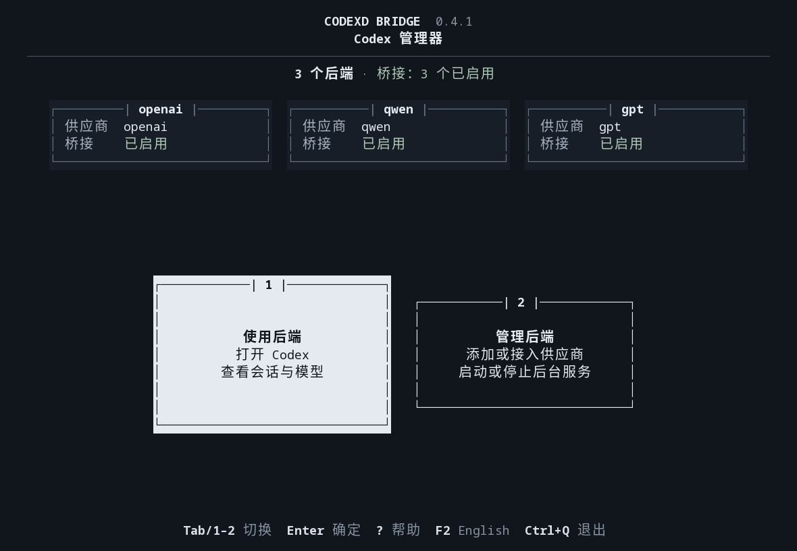
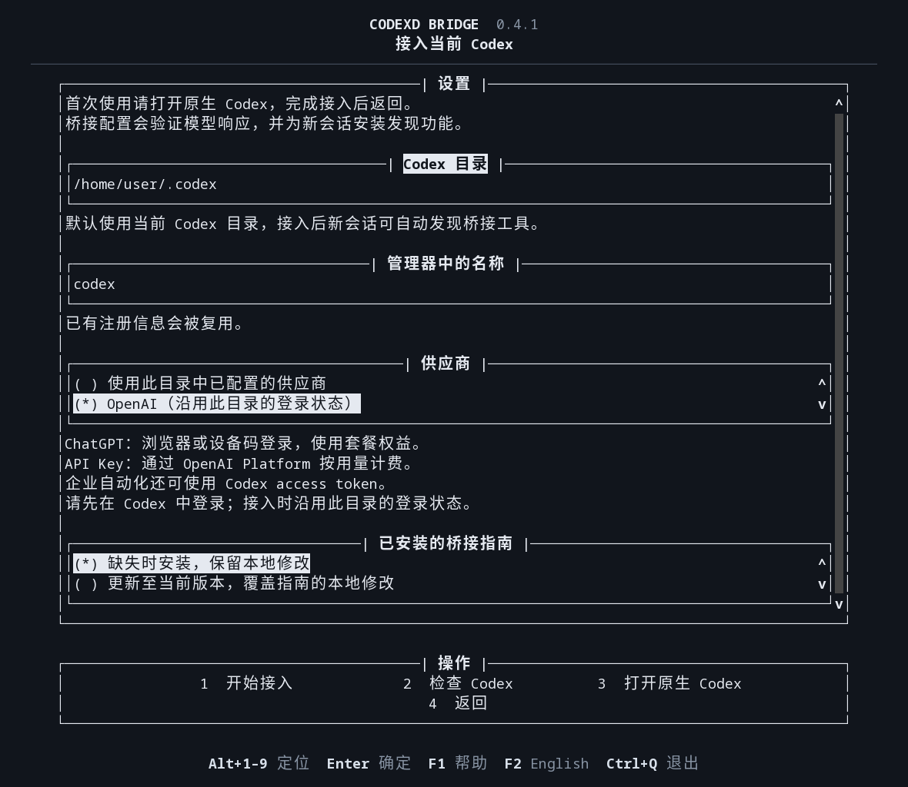
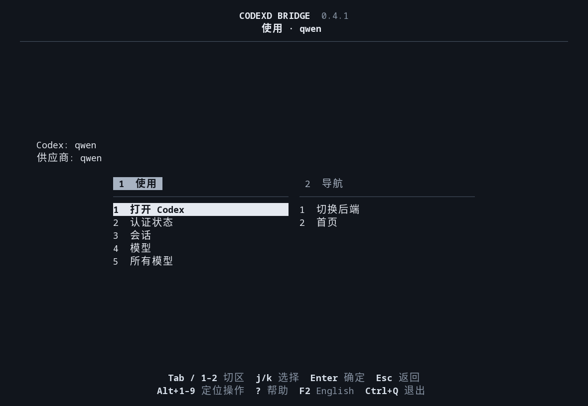
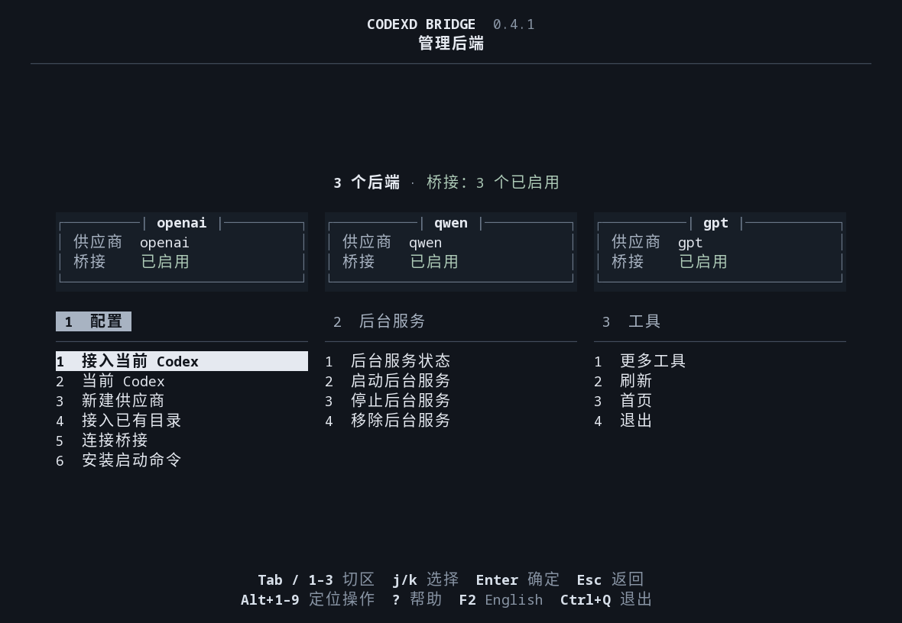

# Codex Daemon Bridge

[](README.md) [](README.zh-CN.md)

管理独立 Codex daemon，发现供应商模型，并通过 MCP 跨供应商派发任务。使用键盘 TUI 完成配置和日常操作。



*实际运行的首页：居中的字符卡片，选中时轻微放大并反色。*

1. **使用后端**：选择已配置的后端，再打开 Codex、查看模型或管理会话。
2. **管理后端**：添加配置、启用桥接工具，以及管理后台服务。

## 使用前提

- Linux（含 WSL）、Python 3.11+ 及其 `venv` 模块，以及 `codex` CLI。
- 支持尚未配置的 Codex：接入时选择 **打开原生 Codex**，完成 Codex 自身的初始配置。

## 安装

1. 从 [GitHub Releases](https://github.com/Aegyce/codexd-bridge/releases) 下载 `codexd_bridge-VERSION.tar.gz`。
2. 解压后，在解压目录运行 `./install.sh`。
3. 按安装器自动打开的 TUI 提示操作。以后在任意目录运行 `codexd-bridge` 即可。

安装器会创建独立 Python 环境，并配置 Bash、Zsh 或 Fish 的命令搜索路径。如果当前终端找不到命令，重新打开终端即可。安装无需 `sudo` 或激活虚拟环境，完成后可以删除下载目录。

<details>
<summary>通过 Git 获取项目并安装</summary>

```bash
git clone https://github.com/Aegyce/codexd-bridge.git
cd codexd-bridge
./install.sh
```

自动化安装可使用 `./install.sh --no-launch`。

</details>

## 配置 Codex 并接入桥接

```bash
codexd-bridge
```

1. 选择 **管理后端 → 接入当前 Codex**。
2. 保留预填的目录和名称，或选择其他 Codex 目录。首次使用或尚未登录时，选择 **打开原生 Codex**，完成其原生接入流程后返回。
3. 选择 **检查 Codex**，读取运行中后台的供应商、模型和认证状态；后台未运行时会标为尚未检查。
4. 使用目录中已配置的供应商；标准 Codex 如果尚未显式设置供应商，选择 **OpenAI**。
5. 选择 **开始接入**。管理器会按需启动后台、验证模型访问、安装指南并注册 MCP 工具。

配置完成后，使用该目录新启动的 Codex 会话会自动发现桥接功能。已有会话可能需要重新连接；配置失败会保留输入，并提供重试入口。



*实际运行的接入表单，图中使用演示目录。*

表单字段从上到下排列，底部按钮按界面编号排列：

| 字段 | 功能与作用 |
| --- | --- |
| Codex 目录 | 选择要启用桥接功能的 Codex 配置目录。默认使用 `CODEX_HOME`，未设置时使用 `~/.codex`；这里指配置目录，不是某个聊天会话。 |
| 管理器中的名称 | 设置后端名称；该目录已注册时复用已有记录。 |
| 供应商 | 使用目录中已配置的供应商，或为标准 Codex 明确选择 OpenAI。 |
| 已安装的桥接指南 | **缺失时安装**会保留现有指南；**更新至当前版本**会替换指南，包括其中的本地修改。 |

| 按钮 | 操作结果 |
| --- | --- |
| 1 · 开始接入 | 按需启动后台、验证模型响应，并为新会话启用桥接发现功能。 |
| 2 · 检查 Codex | 读取运行中后台的供应商、模型和认证信息；不会启动后台或发送模型请求。 |
| 3 · 打开原生 Codex | 进入 Codex 自身的配置和登录界面，退出后返回并保留桥接表单输入。 |
| 4 · 返回 | 回到管理后端页面。 |

OpenAI 的供应商选择与登录方式分别处理。接入时沿用所选 Codex 目录的登录状态：

| 使用方式 | 登录方式 |
| --- | --- |
| ChatGPT 套餐权益 | 浏览器登录（`codex login`）或设备码登录（`codex login --device-auth`） |
| OpenAI Platform 按用量计费 | 由 Codex 管理的 OpenAI API Key |
| 企业自动化 | 由工作区管理员开放权限的 Codex access token |

状态页分别显示当前供应商使用的认证和 Codex 保存的账户；不会仅凭 ChatGPT 账户类型推断浏览器、设备码或访问令牌登录。
设备码属于 ChatGPT 登录流程。具体条件和登录步骤见[官方认证说明](https://learn.chatgpt.com/docs/auth)。

## 添加其他供应商

先在终端导出供应商的密钥环境变量，再打开管理器并选择 **管理后端 → 新建供应商**。服务须支持 Responses API。

| 表单字段 | 填写内容 |
| --- | --- |
| 供应商名称 | 简短名称，例如 `demo`；对应启动命令为 `codex-demo` |
| API 地址 | 供应商的 Responses API 基础地址 |
| API 密钥环境变量 | 环境变量**名称**，例如 `DEMO_API_KEY`；桥接层不保存密钥值 |
| 模型 ID | 供应商提供的准确模型标识 |
| 上下文上限（token） | 模型文档规定的上下文令牌上限 |
| 推理强度（可选） | 留空使用供应商默认值 |
| 新 Codex 目录（可选） | 独立配置的绝对路径；留空使用 `~/.local/share/codexd-bridge/homes/` 下的目录 |
| 启动命令目录 | 安装 `codex-NAME` 的位置，默认为 `~/.local/bin` |
| 已有模型目录文件（可选） | 模型目录文件的绝对路径；留空时只声明填入的模型 |

底部依次为 **1 · 创建供应商**（创建配置、验证真实响应、启用后端并安装启动命令）和 **2 · 返回**（回到管理页面）。若配置未完成，选择 **重试连接** 继续接入。

## 日常操作

下面按界面顺序说明：功能区从左到右，每个区内的选项从上到下。
按数字选择功能区；按 `Alt+数字` 定位区内选项，再按 `Enter` 执行。

### 1. 使用后端

在首页选择 **使用后端**。只有一个后端时直接进入；有多个时先选择名称，再按 `Enter`。下图为选中 `qwen` 后的实际运行界面。



| 功能区 | 选项 | 功能与作用 |
| --- | --- | --- |
| 1 · 使用 | 1 · 打开 Codex | 使用所选后端的配置打开原生 Codex，退出后返回管理器。 |
| 1 · 使用 | 2 · 认证状态 | 显示该后台的供应商、模型、认证和账户信息；不验证模型访问权限或剩余额度。 |
| 1 · 使用 | 3 · 会话 | 列出该后端的会话，可新建、读取、继续、派生任务，或给活动任务补充指令。 |
| 1 · 使用 | 4 · 模型 | 列出该后端的模型；进入模型详情后可验证访问权限或创建会话。 |
| 1 · 使用 | 5 · 所有模型 | 汇总已配置后端的模型目录，并显示发现过程中的错误。 |
| 2 · 导航 | 1 · 切换后端 | 返回后端选择页；配置了多个后端时才显示。 |
| 2 · 导航 | 2 · 首页 | 返回双卡片首页；没有“切换后端”时，编号为 1。 |

### 2. 管理后端

在首页选择 **管理后端**。顶部为只读概览，每个后端的名称、供应商和桥接状态放在同一信息块中，上方显示整体统计。窗口较矮时显示统计；空间不足时标明未展示的后端数量。



| 功能区 | 选项 | 功能与作用 |
| --- | --- | --- |
| 1 · 配置 | 1 · 接入当前 Codex | 打开前面的接入表单，为指定的 Codex 配置目录启用桥接工具。 |
| 1 · 配置 | 2 · 当前 Codex | 检查默认 Codex 目录中运行的后台，即使它尚未加入桥接注册表。 |
| 1 · 配置 | 3 · 新建供应商 | 通过前面的表单创建独立供应商配置和启动命令。 |
| 1 · 配置 | 4 · 接入已有目录 | 将现有 Codex 目录加入注册表，再通过“连接桥接”验证并启用。 |
| 1 · 配置 | 5 · 连接桥接 | 选择已注册的后端，验证模型访问，安装或刷新指南及 MCP 集成。 |
| 1 · 配置 | 6 · 安装启动命令 | 为已注册的后端安装 `codex-NAME`，不启动后台或发送模型请求。 |
| 2 · 后台服务 | 1 · 后台服务状态 | 检查所选后端的 Codex 服务是否正在运行。 |
| 2 · 后台服务 | 2 · 启动后台服务 | 启动所选后端的 Codex 服务。 |
| 2 · 后台服务 | 3 · 停止后台服务 | 确认后停止所选服务，会中断其中的活动任务。 |
| 2 · 后台服务 | 4 · 移除后台服务 | 停止并移除一个后端；默认保留数据，只有明确选择删除时才清除。 |
| 3 · 工具 | 1 · 更多工具 | 打开下方列出的其他操作。 |
| 3 · 工具 | 2 · 刷新 | 重新读取已配置的后端列表和桥接状态。 |
| 3 · 工具 | 3 · 首页 | 返回双卡片首页。 |
| 3 · 工具 | 4 · 退出 | 关闭管理器，已启动的后台服务继续运行。 |

尚未配置后端时，不显示“连接桥接”“安装启动命令”和“后台服务”区，“工具”改为第 2 区。操作需要目标且已配置多个后端时，会先显示后端选择页。

<details>
<summary>更多工具，按按钮顺序说明</summary>

| 选项 | 功能与作用 |
| --- | --- |
| 1 · 创建后台服务 | 创建独立配置，不启动服务或发送模型请求。 |
| 2 · 选择注册文件 | 通过绝对路径打开另一份桥接注册文件。 |
| 3 · 诊断 | 检查安装和后端配置，不发送模型请求。 |
| 4 · MCP 连接 | 显示其他 MCP 客户端接入时使用的 stdio 命令。 |
| 5 · 卸载桥接工具 | 确认后卸载本项目，保留独立后台服务及其数据。 |
| 6 · 验证模型 ID | 使用输入的模型 ID 发送简短请求，完成后删除临时测试会话。 |
| 7 · Codex 启动参数 | 为所选后端的原生 Codex 附加启动参数。 |
| 8 · 返回 | 回到管理页面。 |

尚未配置后端时，不显示“验证模型 ID”和“Codex 启动参数”，“返回”改为第 6 项。

</details>

### 快捷键

界面默认跟随系统语言，按 `F2` 在中文和英文之间切换，并自动记住选择。中文按显示宽度对齐，英文按词换行。

| 快捷键 | 操作 |
| --- | --- |
| `?` / `F1` | 查看帮助；输入框中用 `F1` |
| `F2` | 切换中文 / English，保留当前输入和选择 |
| `Tab` / `Shift+Tab` | 切换功能区或表单字段；菜单中也可用 `h` / `l` 或 `←` / `→` |
| `j` / `k` 或 `↓` / `↑` | 在菜单或列表内选择 |
| `1`–`9` | 定位首页编号卡片，或切换对应功能区 |
| `Alt+1`–`Alt+9` | 定位当前功能区的编号操作，或底部编号按钮，再按 `Enter` 执行 |
| `Home` / `End` | 选择区内首项或末项 |
| `Ctrl+S` / `Esc` / `Ctrl+Q` | 提交表单 / 返回 / 退出 |

终端最小尺寸为 60 列、18 行。停止 daemon 需要确认；免逐次审批的任务派发须在 **连接桥接** 中明确启用。

## 升级

- 在新版下载目录运行 `./install.sh`。安装器会刷新属于本安装且已启用的 MCP 注册和未经修改的指南，无需重启 daemon；构建失败会保留原来的可用版本。
- 如果指南有本地修改或刷新未完成，检查修改后选择 **管理后端 → 接入当前 Codex → 更新至当前版本**。
- 通过其他包管理方式安装时，更新程序包后，在各后端选择 **连接桥接 → 更新已安装的桥接技能**。
- 状态升级会保留已有任务的调用关系。旧版桥接程序无法读取升级后的状态；没有调用关系记录的旧任务需重新创建会话。

## 派发任务

- 每次创建或派生任务都会生成新记录：唯一标识、会话类型、父会话与历史来源、根会话、派生深度、任务要求和验收标准。
- 使用 `session_type` 指定类型（如 `worker` 或 `reviewer`），`prompt` 提供任务要求，`acceptance_criteria` 提供验收标准。省略验收标准时会标为未指定；记录写入首条消息，也可通过会话读取工具查看。
- 子会话可以继续派生，新记录指向直接父会话。默认最多允许八层委派，禁止向调用会话自身或已记录的上级反向派发。引导活动任务时须使用当前 turn ID。

## 移除 daemon 或卸载项目

| 操作 | 命令 | 处理范围 |
| --- | --- | --- |
| 移除单个 daemon | `codexd-bridge daemon remove NAME` | 停止该后台，移除注册、桥接集成和未修改的启动命令；保留配置、凭据和会话 |
| 移除 daemon 及其数据 | `codexd-bridge daemon remove NAME --purge` | 额外删除该 daemon 的数据 |
| 卸载桥接项目 | `codexd-bridge uninstall` | 移除桥接程序及其集成；保留独立 daemon 和数据 |

- **TUI 入口：** 进入 **管理后端**，选择 **移除后台服务** 或 **更多工具 → 卸载桥接工具**。破坏性操作需要确认，删除数据还需输入后端名称。
- 停止或移除 daemon 会中断其活动任务。保留的数据可通过 **接入已有目录** 重新接入；移除失败时保留禁用的注册记录，便于重试。
- 数据删除会拒绝受保护或共享的 Codex 目录，以及包含桥接程序、注册表或其他后端的目录。
- `./uninstall.sh` 也可卸载桥接项目。卸载会保留本地修改过的指南和其他程序的命令。

## 常用命令

| 用途 | 命令 |
| --- | --- |
| 检查安装和供应商配置 | `codexd-bridge doctor` |
| 查看安装版本 | `codexd-bridge --version` |
| 查看自动化命令 | `codexd-bridge --help` |
| 使用其他注册表 | `codexd-bridge --config /absolute/bridge.toml ui` |
| 启动 MCP stdio 入口 | `codexd-bridge serve` |

诊断不会发送模型请求，结果以 JSON 输出；发现检查错误时退出码为 1。也可在 **管理后端 → 更多工具 → 诊断** 中查看。

[发行指南](docs/releasing.md)列出验证结果及未验证的平台和模型；[架构说明](docs/architecture.md)介绍会话与失败处理；[版本变更](CHANGELOG.md)汇总功能改进。

## 许可

原创内容采用 [CC BY-NC 4.0](LICENSE) 许可；商业使用须另行取得[书面授权](COMMERCIAL-LICENSE.md)。第三方依赖保留各自的许可。
